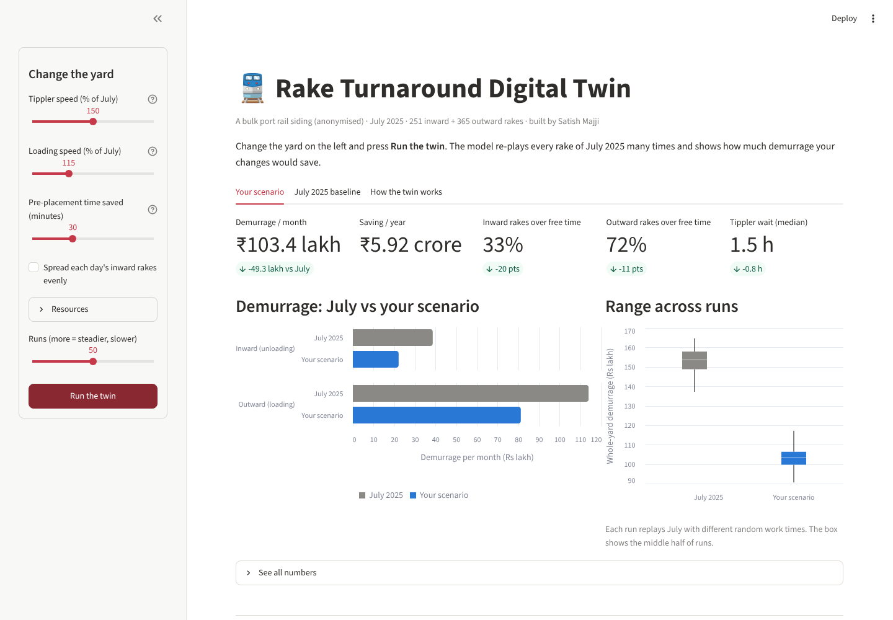

# 🚆 Rake Turnaround Digital Twin — a bulk port rail siding

**A data-driven simulation of one month of real rail operations (July 2025), built to find where demurrage comes from and what fixing it is worth.**

👉 **Live dashboard:** _add your Streamlit link here_
👉 **Video walkthrough:** _add your YouTube link here_



---

## The problem

A port rail siding handled **251 inward rakes** (unloading) and **365 outward rakes** (loading) in July 2025, and paid **₹1.46 crore in demurrage** in that one month. Where does that time go, and which fix would pay back most?

## What I built

1. **Data foundation (Phase 1):** cleaned and anonymised a month of rake records and decoded the demurrage contract rule. Recalculated bills match the site records **to the rupee**.
2. **Simulation twin (Phase 2):** a SimPy model of the yard covering reception, pre-placement steps, 1 tippler, manual lines, silo, wagon loader, 10 locos, the linked inward → back-load → outward cycle and the demurrage slabs. It is validated against July **within ±5%** on every key measure.
3. **Interactive dashboard (Phase 3):** change tippler speed, loading speed, placement time, locos and lines, and the twin re-plays July to show the result.

## Key findings

| # | Finding |
|---|---|
| 1 | **Loading, not unloading, drives the bill:** outward demurrage ₹107 lakh vs inward ₹38 lakh. 83% of outward rakes exceed free time. |
| 2 | **Every wagon-loader rake paid demurrage.** Its median loading time (6.2 h) is longer than the whole free time (5.5 h). |
| 3 | **The tippler runs at about one-third of its rated speed** (about 10 wagons/h tipping vs 24 rated) and is busy 61% of the month, so queues form. |
| 4 | **Clustered arrivals pay more than 3× the demurrage** of rakes that arrive alone. Busy days alone do not. |
| 5 | **Records are padded to the free-time limit:** 42% of chargeable inward rakes are recorded at exactly 6:30 h, so real work is faster than the records show. |
| 6 | **Locos are not the constraint.** Even with 5 locos, demurrage barely changes. |

## What fixing it is worth (twin estimates on July traffic)

| Change | Saving / month |
|---|---|
| Loading 15% faster | ₹20 lakh |
| Pre-placement steps 30 min quicker | ₹18 lakh |
| Tippler 25% faster | ₹8 lakh |
| **All combined** | **₹44 lakh (≈29%, ≈ ₹5 crore a year)** |

## How to run it

```bash
pip install -r requirements.txt
streamlit run app.py
```

## Project structure

| Path | What it is |
|---|---|
| `phase1_clean.py` | Cleans and anonymises the raw data, decodes demurrage |
| `phase1_analysis.py` | Baseline analysis, charts, simulation inputs |
| `rake_twin_sim.py` | The digital twin (SimPy) |
| `phase2_run.py` | Validation + what-if scenarios |
| `app.py` | Interactive dashboard (Streamlit) |
| `data/clean/` | Anonymised July data and site parameters |
| `outputs/` | Charts, validation and scenario tables |
| `reports/` | Phase 1 and Phase 2 reports |

Every line of code carries a plain-English explanation.

## Honest limits

- Route conflicts (shared approach lines, hand-operated points, level crossings) are not yet modelled. This is the planned version 2.
- Shunting moves use a fixed 30 minutes.
- One month of data; savings are model estimates, not guarantees.

## Data and privacy

All customer, station and site names are replaced with codes. Raw data is not included in this repository.

---

**Satish Majji** · Industrial rail & bulk logistics · 28+ years in railway operations
YouTube: *Satish Majji | Beyond the Obvious* (@BeyondTheObviousSM) · Web: satishmajji.com · LinkedIn: _add link_
