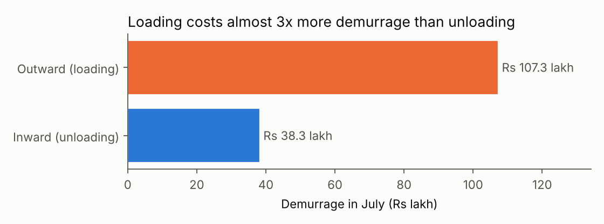
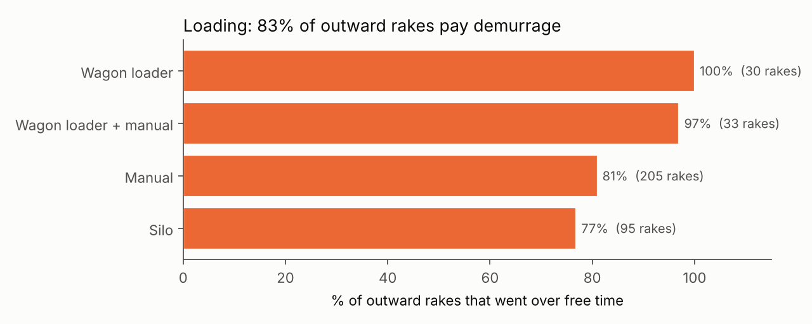
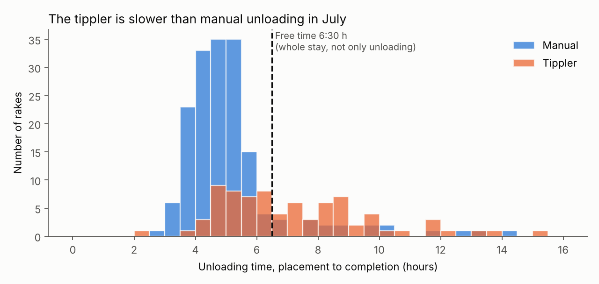
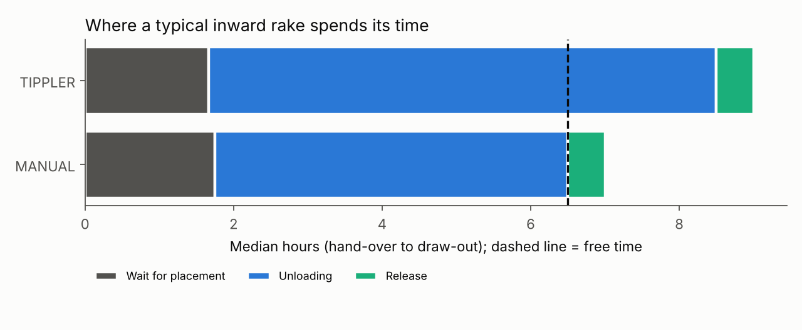
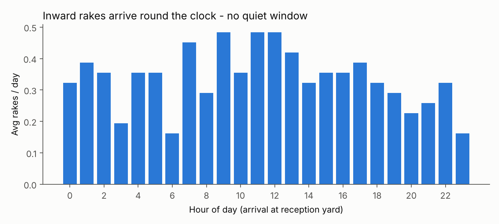
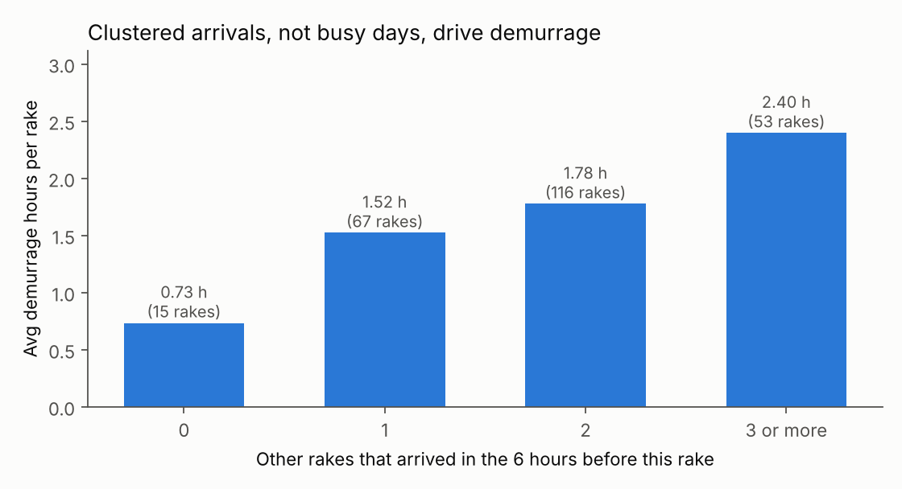
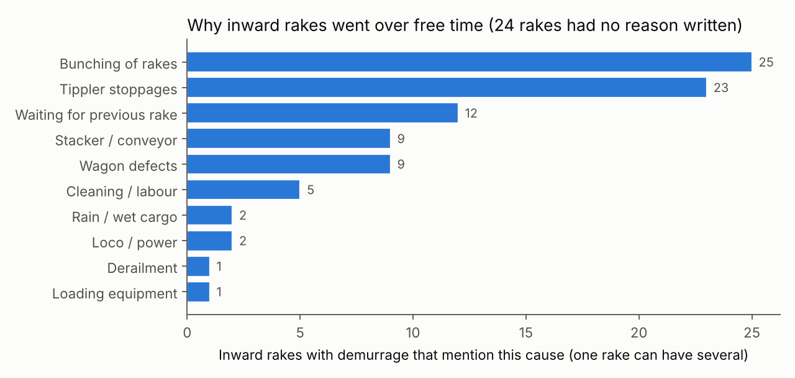
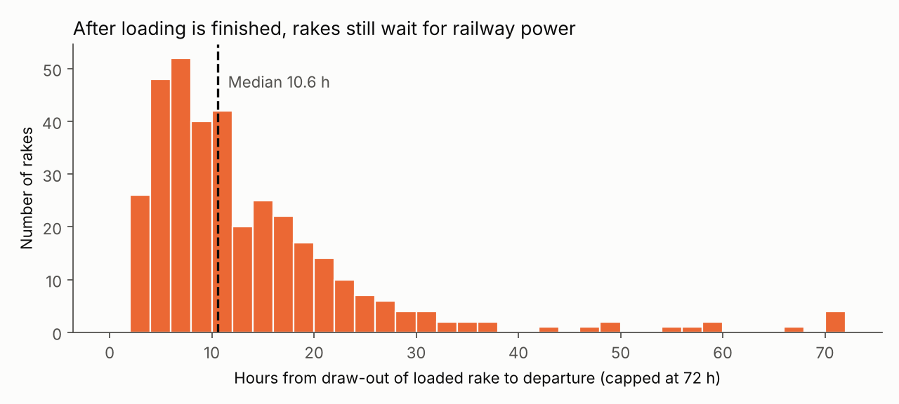

# Rake Turnaround Digital Twin — Phase 1: Baseline Report

**Site:** A bulk port rail siding (anonymised) · **Period:** July 2025 (one full month) · **Author:** Satish Majji

> All customer and station names are replaced with codes (CUST-xx, STN-xx). No site, company or customer is identified.

---

## 1. What this phase did

1. Cleaned one full month of rake records: **251 inward rakes** (loaded rakes arriving for unloading) and **365 outward rakes** (rakes placed for loading).
2. Re-built the **demurrage rule** from the data and re-calculated every bill.
3. Tagged the free-text delay remarks into simple causes.
4. Measured the baseline performance and saved the input numbers for the simulation (Phase 2).

**Validation result:** the re-calculated demurrage matches the site records **to the rupee**: ₹38,27,408 inward and ₹1,07,31,713 outward. The demurrage logic used in the twin is correct.

---

## 2. The demurrage rule (decoded)

- The clock starts at **railway hand-over** and stops at **draw-out**.
- Free time: **6:30 h** for inward unloading; **5:30 h** for most outward loading (4:30 h for limestone/pellets, 7:30–9:30 h for covered wagons).
- Hours over free time are **rounded up** to the next full hour.
- Charge = hours × wagons worked × **₹150**, rising in slabs:

| Demurrage hours | Rate |
|---|---|
| 0–6 | base (₹150) |
| 6–12 | +10% |
| 12–24 | +25% |
| 24–48 | +50% |
| 48–72 | 2× |
| over 72 | 3× |

- Customer-owned rakes (including container rakes) pay no demurrage.

## 3. Site parameters used in the twin

From the site expert and plant documents (saved in `data/clean/site_parameters.json`):

| Item | Value |
|---|---|
| Sidings | 21, about 52.5 km of track, 30 km/h limit |
| Signalling | Non-interlocking; 30 motor points + 45 hand-operated points |
| Level crossings | 25 (4 manned) |
| Reception yards | 2 yards, 13 lines of 713–1,016 m |
| Shunting locos | 10 (4 × 1,200 HP, 6 × 3,100 HP); max 1 under maintenance at a time → at least 9 available |
| Wagon tippler | One tippler, one rake at a time. Rated 24 tips/hour (2,700–3,000 TPH) → a 59-wagon rake in about 2.5 h |
| Manual unloading | One rake per line; up to 5 manual lines worked in parallel in July |
| Weighment | Every inward and outward rake is weighed |

---

## 4. July in one table

| | Inward (unloading) | Outward (loading) |
|---|---|---|
| Rakes | 251 (about 8 a day) | 365 (56% back-loaded inward rakes) |
| Median wait for placement | 1.75 h | 2.2 h |
| Median work time | Manual 4.75 h · Tippler 6.8 h | Manual 5.2 h · Silo 4.1 h · Wagon loader 6.2 h |
| Free time | 6:30 h | 5:30 h (mostly) |
| Rakes over free time | **131 (52%)** | **303 (83%)** |
| Demurrage hours | 446 | 1,266 |
| Demurrage cost | **₹38.3 lakh** | **₹107.3 lakh** |

---

## 5. Seven key findings

### Finding 1 — Loading, not unloading, is where the money goes
Outward demurrage (₹1.07 crore) is **almost 3× the inward bill**. **83% of outward rakes** go over free time. The typical outward rake waits 2.2 h for placement and loads for 5.2 h, which already exceeds the 5:30 h free time before any delay.

### Finding 2 — Every wagon-loader rake paid demurrage
The wagon loader's median loading time (6.2 h) is longer than the whole free time. **All 30 wagon-loader rakes** and 97% of wagon-loader + manual rakes went over. The silo is the best loading method, and even it is over free time in 77% of cases.

### Finding 3 — The tippler runs at about one-third of its rated speed
Rated: **24 wagons per hour** (a full rake in about 2.5 h). Actual July median: **8.5 wagons per hour** (6.8 h per rake), about **35% of rated speed**. Manual unloading (4.75 h) is faster than the tippler. The remarks show frequent short stops ("dual mode", hopper jams, conveyor stops), a few long breakdowns (pump failure, clamp oil leak) and waiting for the previous empty rake to be drawn out.

### Finding 4 — Clustered arrivals drive inward demurrage, not busy days
Days with 10+ rakes did **not** pay more demurrage per rake than quiet days. What matters is **clustering within a few hours**. A rake that arrives after 3+ others in the previous 6 hours pays **over 3× the demurrage** of a rake that arrives alone.

### Finding 5 — Named causes of inward delay
Among inward rakes that paid demurrage: **bunching (25)**, **tippler stoppages (23)** and **waiting for the previous rake to clear (12)** lead. **24 rakes paid demurrage with no reason written**, which is a gap in record-keeping.

### Finding 6 — A few bad rakes make most of the inward bill
The worst 10% of inward rakes cause **46% of inward demurrage**. Fixing long breakdowns matters more than shaving minutes off normal rakes.

### Finding 7 — The hidden wait after the work is done
After a loaded rake is drawn out, it waits a **median of 10.6 hours** (10% wait over 25 h) for railway power before departure. This time is outside the siding's demurrage, but it keeps wagons and yard lines occupied.

---

## 6. Data quality notes

| Issue | How it is handled |
|---|---|
| Summary sheets add the detail total a second time | Used the detail rows only |
| "Completion → draw-out" is almost always exactly 0:30 | Treated as a fixed 30-minute standard |
| One container rake recorded with ₹0 demurrage and no remark | All July container rakes are customer-owned → treated as customer-owned |
| 2 unusual inward rakes (container rake of 43 h; one rake of 5 min) | Kept in totals, excluded from curve fitting |
| 24 inward demurrage rakes with no reason written | Reported as "no reason recorded" |
| Outward remarks often list cleaning times as routine notes | Outward cause tags are indicative only |

---

## 7. Inputs saved for the simulation (Phase 2)

Saved in `outputs/sim_inputs.json`:
- Hourly arrival profile (24 values) and gaps between arrivals (median 2.5 h)
- Mode share: 69% manual, 31% tippler
- Unloading time: tippler fits a lognormal curve well. Manual does not fit a smooth curve, so the model will **sample directly from the real July times**.
- Loading time curves by method (manual, silo, wagon loader)
- Back-load share: 56% of outward rakes are re-used inward rakes
- Wait-for-railway-power curve (lognormal, good fit)
- The demurrage rule and the site parameters

---

## 8. Next: Phase 2 (simulation twin)

Build the yard in Python (SimPy): reception lines, 10 locos, one tippler, manual lines, silo and wagon loader, and the inward → back-load → outward cycle. **First prove it reproduces July** (turnaround and demurrage within an agreed margin). Then test what-if scenarios such as faster tippler running, smoother arrivals and faster loading.

**Optional, but valuable:** one more month of data, to test the model on data it has not seen.
