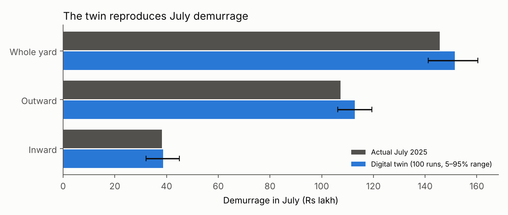
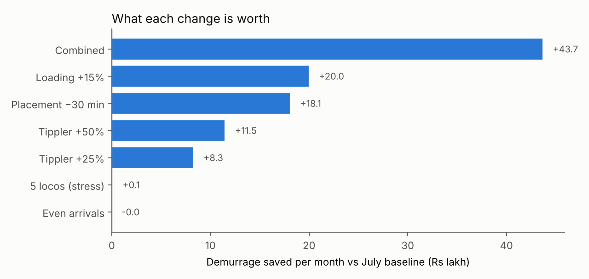

# Rake Turnaround Digital Twin — Phase 2: Simulation Report

**Site:** A bulk port rail siding (anonymised) · **Data:** July 2025 (251 inward + 365 outward rakes) · **Author:** Satish Majji

---

## 1. What the twin is

A computer model of the yard, built in Python (SimPy), that plays a whole month rake by rake:

- **Rakes arrive** at the real July hand-over times.
- **Pre-placement steps** (examination, weighment, line clearing) take a time drawn from real July records.
- Each rake **waits for its working point**: 1 tippler, 5 manual unloading lines, 2 silo lines, 2 wagon-loader lines, 6 manual loading lines.
- A **loco** is needed for every placement and draw-out (9 of the 10 locos available).
- **Work times** are drawn at random from real July times.
- **Back-loading is linked:** 187 outward rakes can start only when their own inward rake has been unloaded and drawn out.
- **Demurrage** is calculated with the real slab rule.

Each scenario is played **100 times**, so results come with a normal range, not a single guess.

---

## 2. Calibration (two settings fitted to July)

| Setting | Value | Why it is needed |
|---|---|---|
| Tippler blocking share | **0.70** | Up to 3 "tippler" rakes were recorded as placed at the same time, though only one can tip. About 30% of the recorded tippler time is finishing work that does not stop the next rake. |
| Inward work-time factor | **0.85** | 96 of 230 chargeable inward rakes are recorded at **exactly** the 6:30 h free time, and only 3 under it. Early-finishing rakes are written down at the free-time limit, so recorded inward times are padded. True work is about 15% shorter. |

Outward records look genuine and need no adjustment.

---

## 3. Validation: does the twin reproduce July?

| Measure | Actual July | Twin (average of 100 runs) | Twin range (5–95%) | Error |
|---|---|---|---|---|
| Inward: % rakes over free time | 52.2% | 53.4% | 49.8–57.8% | +2.3% |
| Inward: demurrage hours | 446 | 441 | 367–513 | −1.2% |
| Inward: demurrage | ₹38.3 lakh | ₹38.6 lakh | ₹32.2–45.0 lakh | +0.9% |
| Outward: median hours in yard | 8.5 | 8.2 | 7.9–8.4 | −3.6% |
| Outward: % rakes over free time | 83.0% | 83.4% | 80.8–86.0% | +0.4% |
| Outward: demurrage hours | 1,266 | 1,320 | 1,242–1,396 | +4.2% |
| Outward: demurrage | ₹107.3 lakh | ₹112.9 lakh | ₹106.1–119.4 lakh | +5.2% |
| **Whole yard: demurrage** | **₹145.6 lakh** | **₹151.5 lakh** | ₹141.2–160.3 lakh | **+4.0%** |

**Every measure is within ±5.2% of reality**, and every actual July value falls inside the twin's normal range. The twin is fit for testing changes.

---

## 4. What-if results

Each change is tested on the same July traffic. Savings are compared with the twin's own baseline (₹151.5 lakh).

| Scenario | Demurrage / month | Saving / month | Saving / year | % rakes over free (in / out) |
|---|---|---|---|---|
| Baseline (July 2025) | ₹151.5 lakh | — | — | 53% / 83% |
| Tippler 25% faster | ₹143.1 lakh | ₹8.3 lakh | ₹1.0 crore | 47% / 83% |
| Tippler 50% faster | ₹140.0 lakh | ₹11.5 lakh | ₹1.4 crore | 42% / 83% |
| Pre-placement steps 30 min quicker | ₹133.4 lakh | ₹18.1 lakh | ₹2.2 crore | 44% / 79% |
| Loading 15% faster | ₹131.5 lakh | ₹20.0 lakh | ₹2.4 crore | 53% / 78% |
| Inward arrivals spread evenly | ₹151.5 lakh | ≈ 0 | ≈ 0 | 53% / 83% |
| Only 5 locos (stress test) | ₹151.4 lakh | ≈ 0 | ≈ 0 | 53% / 83% |
| **Combined** (tippler +25%, even arrivals, placement −30 min, loading +15%) | **₹107.8 lakh** | **₹43.7 lakh** | **₹5.2 crore** | 37% / 73% |

### What the results say

1. **Loading speed is the biggest single lever.** 15% faster loading saves about ₹20 lakh a month, because outward rakes carry most of the bill.
2. **Pre-placement time is the second lever, and the cheapest.** Cutting 30 minutes from examination, weighment and line-clearing saves about ₹18 lakh a month, on both inward and outward rakes. It needs planning and coordination, not new equipment.
3. **Tippler improvement helps inward only.** It cuts the share of inward rakes over free time from 53% to 42–47%, worth ₹8–12 lakh a month.
4. **Locos are not the constraint.** Even with only 5 locos, demurrage hardly changes (assuming 30-minute shunting moves). The fleet has spare capacity.
5. **Together, the changes cut demurrage by about 29%**: roughly ₹44 lakh a month, or ₹5 crore a year.

---

## 5. Honest limits of version 1

- **Spreading arrivals shows no gain in this version.** Phase 1 showed that clustered rakes pay more demurrage. The twin does not yet model **route conflicts** (shared approach lines, hand-operated points, level crossings), which is probably how clustering causes delay in real life. Its pre-placement times are drawn from July records that already contain those delays, so the effect is not separated out. **Next step:** model the main routes and point zones as shared resources.
- **Shunting moves use a fixed 30 minutes.** Real move times depend on distance and points.
- **One month of data.** Testing the twin on a second month would make the results stronger.
- **Savings are model estimates** under July traffic, not guarantees. The 5–95% ranges are in `outputs/phase2_scenarios.csv`.

---

## 6. Files

| File | What it is |
|---|---|
| `rake_twin_sim.py` | The twin (every line explained in plain English) |
| `phase2_run.py` | Validation + scenarios + charts |
| `outputs/phase2_validation.csv` | Actual vs twin table |
| `outputs/phase2_scenarios.csv` | All scenario results with ranges |
| `outputs/charts/09_validation.png`, `10_scenario_savings.png` | Charts |
